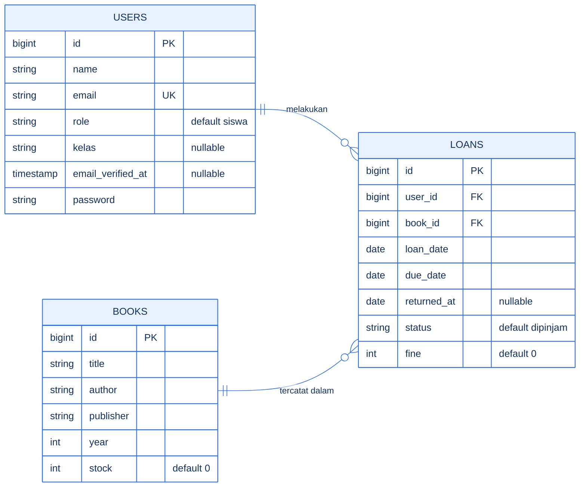

# Sistem Peminjaman Buku Perpustakaan

Aplikasi web berbasis Laravel dan Filament untuk mengelola koleksi buku, anggota, dan transaksi peminjaman di perpustakaan sekolah.

## Daftar Isi

1. [Teknologi](#teknologi)
2. [Memulai](#memulai)
3. [Deskripsi Program](#deskripsi-program)
4. [ERD](#erd)
5. [Dokumentasi Fungsi / Prosedur](#dokumentasi-fungsi--prosedur)
6. [Debugging](#debugging)
7. [Laporan Evaluasi](#laporan-evaluasi)

## Teknologi

- PHP 8.2 atau lebih baru
- Laravel 12
- Filament 4 (panel admin dan antarmuka)
- MySQL (via XAMPP)
- Composer

## Memulai

### 1. Ambil kode proyek

```bash
git clone https://github.com/USERNAME-ANDA/NAMA-REPO.git
cd NAMA-REPO
```

### 2. Pasang dependency

```bash
composer install
```

### 3. Siapkan environment

```bash
cp .env.example .env
php artisan key:generate
```

### 4. Siapkan database

Buat database baru (contoh: `peminjaman_buku`) lewat phpMyAdmin. File `.env.example` bawaan memakai SQLite, jadi ubah pengaturannya ke MySQL:

```env
DB_CONNECTION=mysql
DB_HOST=127.0.0.1
DB_PORT=3306
DB_DATABASE=peminjaman_buku
DB_USERNAME=root
DB_PASSWORD=
```

### 5. Buat tabel dan data contoh

```bash
php artisan migrate --seed
```

Perintah ini membuat semua tabel dan mengisi data contoh berikut:

| Peran | Email | Password |
|-------|-------|----------|
| Admin | `admin@perpus.test` | `password` |
| Siswa | `siswa@perpus.test` | `password` |

Seeder juga menambahkan tiga buku: Laskar Pelangi, Bumi, dan Belajar Laravel. Ganti password contoh ini sebelum aplikasi dipakai sungguhan.

### 6. Jalankan aplikasi

```bash
php artisan serve
```

Buka `http://127.0.0.1:8000/admin` lalu masuk memakai salah satu akun di atas. Halaman `/` hanya menampilkan halaman `welcome` bawaan Laravel.

## Deskripsi Program

Seluruh fitur diakses lewat panel Filament di alamat `/admin`. Halaman login dan pendaftaran sudah aktif, dan akun yang mendaftar sendiri otomatis berperan **siswa**.

### Peran pengguna

Peran ditentukan oleh kolom `role` di tabel `users`:

- **admin**: mengelola buku dan anggota, serta memantau seluruh peminjaman.
- **siswa** (peran bawaan): meminjam buku dan melihat riwayat pinjamannya sendiri. Data siswa dilengkapi `kelas`.

### Hak akses

| Fitur | Admin | Siswa |
|-------|-------|-------|
| Melihat daftar buku | Ya | Ya |
| Tambah, ubah, hapus buku | Ya | Tidak |
| Meminjam buku | Tidak (tombol disembunyikan) | Ya |
| Melihat peminjaman | Semua data | Hanya miliknya sendiri |
| Mengembalikan buku | Ya | Ya (pinjamannya sendiri) |
| Mengelola pengguna | Ya | Tidak |

### Aturan peminjaman

1. Siswa menekan tombol **Pinjam** pada daftar buku. Tombol nonaktif bila stok buku habis.
2. Setiap siswa hanya boleh memiliki **maksimal 3 buku** yang berstatus `dipinjam` sekaligus.
3. Sistem membuat data di tabel `loans` dengan `loan_date` hari ini, `due_date` **7 hari** setelahnya, dan `status` awal `dipinjam`. Stok buku berkurang 1.
4. Saat tombol **Kembalikan** ditekan, `returned_at` diisi, `status` menjadi `dikembalikan`, dan stok buku bertambah 1.
5. Bila pengembalian melewati `due_date`, denda dihitung **Rp1.000 per hari keterlambatan** dan disimpan di kolom `fine`.

### Dashboard

Halaman utama panel menampilkan tiga statistik: jumlah judul buku, jumlah anggota (siswa), dan jumlah buku yang sedang dipinjam.

## ERD

Tabel `users` dan `books` masing-masing berelasi one-to-many dengan tabel `loans`. Bila user atau buku dihapus, data peminjaman terkait ikut terhapus (`cascadeOnDelete`).



## Dokumentasi Fungsi / Prosedur

### Route

- `routes/web.php`: `GET /` menampilkan halaman `welcome`.
- Seluruh halaman aplikasi (login, daftar, dashboard, buku, peminjaman, pengguna) dibuat otomatis oleh panel Filament di `app/Providers/Filament/AdminPanelProvider.php` dengan alamat dasar `/admin`.

### Model `User` (`app/Models/User.php`)

- `$fillable`: `name`, `email`, `password`, `role`, `kelas`.
- `$hidden`: menyembunyikan `password` dan `remember_token` ketika data dikonversi ke array atau JSON.
- `casts()` → `array`: mengubah `email_verified_at` ke datetime dan meng-hash `password` secara otomatis.
- `isAdmin()` → `bool`: bernilai `true` bila `role` adalah `admin`, selain itu `false`.

### Model `Book` (`app/Models/Book.php`)

- `$fillable`: `title`, `author`, `publisher`, `year`, `stock`.

### Model `Loan` (`app/Models/Loan.php`)

- `$fillable`: `user_id`, `book_id`, `loan_date`, `due_date`, `returned_at`, `status`, `fine`.
- `$casts`: mengubah `loan_date`, `due_date`, dan `returned_at` menjadi objek tanggal (Carbon).
- `user()` → `BelongsTo`: mengambil data peminjam berdasarkan `user_id`. Contoh: `$loan->user->name`.
- `book()` → `BelongsTo`: mengambil data buku yang dipinjam berdasarkan `book_id`. Contoh: `$loan->book->title`.

### Resource Filament (`app/Filament/Resources`)

- **`Books/BookResource`**: semua pengguna boleh melihat daftar buku, sedangkan tambah, ubah, dan hapus hanya untuk admin (dicek lewat `isAdmin()`).
  - `BooksTable`: berisi aksi **pinjam** (cek stok, batas 3 buku, buat data `loans`, kurangi stok). Aksi ini hanya tampil untuk siswa.
  - `BookForm`: formulir judul, penulis, penerbit, tahun, dan stok.
- **`Loans/LoanResource`**: daftar peminjaman. Siswa hanya melihat data miliknya (`getEloquentQuery()` memfilter `user_id`), sedangkan admin melihat semuanya. Pembuatan, pengubahan, dan penghapusan manual ditolak untuk semua peran.
  - `LoansTable`: berisi aksi **kembalikan** (isi `returned_at`, ubah `status`, hitung denda, tambah stok). Aksi ini hanya tampil bila `status` masih `dipinjam`.
- **`Users/UserResource`**: pengelolaan akun, hanya untuk admin. Formulir menyediakan pilihan peran `admin` atau `siswa`, isian kelas, dan password (wajib saat membuat akun baru).

### Widget (`app/Filament/Widgets/StatsOverview.php`)

- `getStats()` → `array`: menghasilkan tiga kartu statistik: Judul Buku, Anggota, dan Sedang Dipinjam.

## Debugging

### Catatan perbaikan pada kode saat ini

**1. Model `Book` dan `User` belum punya relasi ke `Loan`.**
Akibatnya, `$book->loans` dan `$user->loans` menimbulkan error karena relasinya tidak ada. Solusinya, tambahkan relasi `hasMany`:

```php
// app/Models/Book.php dan app/Models/User.php
use Illuminate\Database\Eloquent\Relations\HasMany;

public function loans(): HasMany
{
    return $this->hasMany(Loan::class);
}
```

**2. Pinjam dan kembali belum memakai transaksi database.**
Akibatnya, bila data peminjaman berhasil dibuat tetapi pengurangan stok gagal, stok bisa tidak sesuai. Solusinya, bungkus langkah-langkahnya dengan `DB::transaction()`:

```php
use Illuminate\Support\Facades\DB;

DB::transaction(function () use ($record) {
    Loan::create([
        'user_id'   => auth()->id(),
        'book_id'   => $record->id,
        'loan_date' => now(),
        'due_date'  => now()->addDays(7),
    ]);
    $record->decrement('stock');
});
```

**3. Isi kolom `status` berupa teks bebas.**
Akibatnya, gampang salah ketik (misalnya `dikembalikan` dan `dikembalikan ` dengan spasi) sehingga filter tidak cocok. Solusinya, gunakan konstanta atau enum PHP.

**4. Batas pinjam, lama pinjam, dan tarif denda tertulis langsung di kode.**
Akibatnya, mengubah aturan berarti mengubah kode di beberapa tempat. Solusinya, simpan nilainya di file konfigurasi atau konstanta.

### Error yang sering terjadi

**`Base table or view not found` / `Failed to open the referenced table` saat migrate**
- Penyebab: migration `loans` dieksekusi sebelum `users` atau `books` karena timestamp pada nama filenya lebih lama.
- Solusi: ubah timestamp file migration `loans` agar yang paling baru, lalu jalankan `php artisan migrate:fresh --seed`.

**`SQLSTATE[23000]: Integrity constraint violation`**
- Penyebab: `user_id` atau `book_id` yang diisi tidak ditemukan di tabel induknya.
- Solusi: pastikan data user dan buku sudah ada sebelum membuat data peminjaman.

**`MassAssignmentException`**
- Penyebab: kolom belum didaftarkan di `$fillable`.
- Solusi: masukkan kolom tersebut ke `$fillable` pada model.

**`Call to undefined relationship`**
- Penyebab: fungsi relasi belum ditulis di model.
- Solusi: tambahkan fungsi relasi seperti pada catatan perbaikan di atas.

**`Class "App\Models\Loan" not found`**
- Penyebab: namespace atau nama file tidak sesuai.
- Solusi: periksa `namespace` dan nama file, lalu jalankan `composer dump-autoload`.

**Halaman `/admin` menampilkan 403 atau menu tidak muncul**
- Penyebab: akun yang dipakai berperan `siswa`, sedangkan halaman tersebut khusus admin.
- Solusi: masuk memakai akun admin, atau ubah kolom `role` akun terkait menjadi `admin`.

**`SQLSTATE[HY000] [1049] Unknown database`**
- Penyebab: database belum dibuat, atau nama di `DB_DATABASE` berbeda dengan yang ada di phpMyAdmin.
- Solusi: buat database terlebih dahulu, samakan namanya dengan `.env`, lalu jalankan `php artisan migrate --seed`.

**`SQLSTATE[HY000] [2002] No connection could be made`**
- Penyebab: MySQL di XAMPP belum menyala, atau `DB_HOST` dan `DB_PORT` tidak sesuai.
- Solusi: nyalakan MySQL lewat XAMPP Control Panel, lalu periksa `DB_HOST=127.0.0.1` dan `DB_PORT=3306`.

**`No application encryption key has been specified`**
- Penyebab: application key belum dibuat setelah menyalin `.env`.
- Solusi: jalankan `php artisan key:generate`.

**Login gagal memakai akun contoh**
- Penyebab: seeder belum dijalankan, atau database lama masih berisi data yang berbeda.
- Solusi: jalankan `php artisan migrate:fresh --seed`, lalu masuk memakai `admin@perpus.test` atau `siswa@perpus.test` dengan password `password`. Perintah ini menghapus seluruh data yang ada.

**Halaman `/admin` tampil tanpa gaya atau tombol tidak berfungsi**
- Penyebab: aset Filament (CSS dan JavaScript) belum tersedia di folder `public`.
- Solusi: jalankan `php artisan filament:assets`, lalu `php artisan optimize:clear`.

**`419 Page Expired`**
- Penyebab: sesi atau token CSRF kedaluwarsa, atau cache lama masih tersimpan.
- Solusi: muat ulang halaman lalu login kembali. Bila masih terjadi, jalankan `php artisan optimize:clear`.

**Perubahan `.env` tidak berpengaruh**
- Penyebab: konfigurasi lama masih tersimpan di cache.
- Solusi: jalankan `php artisan config:clear`, lalu restart `php artisan serve`.

**Tombol Pinjam nonaktif atau muncul notifikasi "Maksimal pinjam 3 buku"**
- Penyebab: ini bukan error, melainkan aturan aplikasi. Tombol nonaktif bila stok buku 0, dan notifikasi muncul bila siswa sudah memegang 3 buku yang belum dikembalikan.
- Solusi: tambah stok lewat akun admin, atau kembalikan salah satu buku terlebih dahulu.

### Tips menelusuri bug

- Tampilkan isi variabel dengan `dd($loan);` atau `dump($request->all());`
- Tulis ke log dengan `Log::info('data pinjam', $data);`, lalu buka `storage/logs/laravel.log`.
- Lihat semua route (termasuk milik Filament) dengan `php artisan route:list`
- Periksa status migration dengan `php artisan migrate:status`
- Coba model lewat console memakai `php artisan tinker`, contohnya `App\Models\Loan::with('user','book')->first();`
- Set `APP_DEBUG=true` di file `.env` selama pengembangan supaya pesan error tampil lengkap.

## Laporan Evaluasi

### Tujuan

Membangun aplikasi Laravel untuk mengelola data buku dan transaksi peminjaman di perpustakaan sekolah.

### Hasil yang dicapai

- Desain database: tabel `users`, `books`, dan `loans` dengan relasi one-to-many dan foreign key.
- Migration, model `Book`, `Loan`, `User`, serta relasi `user()` dan `book()` pada `Loan`.
- Seeder berisi dua akun contoh (admin dan siswa) dan tiga buku.
- Panel Filament di `/admin` dengan login, pendaftaran, dan dashboard statistik.
- Halaman pengelolaan buku, peminjaman, dan pengguna.
- Pembagian peran `admin` dan `siswa`, termasuk pembatasan akses lewat `isAdmin()` dan pembatasan data peminjaman per siswa.
- Alur peminjaman: pinjam dengan batas 3 buku dan jatuh tempo 7 hari, pengembalian, penyesuaian stok otomatis, dan denda Rp1.000 per hari keterlambatan.
- Dokumentasi: deskripsi program, referensi kode, dan panduan pemecahan masalah.

### Kendala

- Tabel `loans` harus dibuat setelah `users` dan `books`. Hal ini sudah diatasi dengan memberi timestamp migration `loans` yang paling baru.

### Kekurangan

- Relasi `loans()` (`hasMany`) belum ada di model `Book` dan `User`.
- Proses pinjam dan kembali belum dibungkus `DB::transaction()`, sehingga stok bisa tidak sinkron bila terjadi kegagalan di tengah proses.
- Isian `status` masih berupa teks bebas, belum memakai konstanta atau enum.
- Batas 3 buku, jatuh tempo 7 hari, dan denda Rp1.000 masih tertulis langsung di kode, belum disimpan sebagai pengaturan.
- Admin tidak bisa menambah atau mengoreksi data peminjaman secara manual karena pembuatan dan pengubahan ditolak.
- Siswa belum dicegah meminjam judul buku yang sama lebih dari sekali.
- Belum ada pengujian fitur. Folder `tests` hanya berisi contoh bawaan Laravel.
- Berkas ekspor database (`.sql`) belum disertakan di dalam proyek.

### Rencana perbaikan

1. Tambahkan relasi `hasMany` di model `Book` dan `User`.
2. Bungkus proses pinjam dan kembali dengan `DB::transaction()`.
3. Ganti isian `status` dengan konstanta atau enum.
4. Pindahkan batas pinjam, lama pinjam, dan tarif denda ke file konfigurasi.
5. Tambahkan pengecekan agar buku yang sama tidak bisa dipinjam dua kali oleh siswa yang sama.
6. Tulis pengujian untuk alur pinjam, kembali, dan perhitungan denda.
7. Ekspor database ke `database/peminjaman_buku.sql`.

### Kesimpulan

Fitur utama aplikasi sudah berjalan, mulai dari pengelolaan buku dan anggota, peminjaman dan pengembalian dengan stok otomatis, denda keterlambatan, sampai pembatasan akses berdasarkan peran. Tahap berikutnya adalah memperkuat keandalan lewat transaksi database, enum, dan pengujian.
